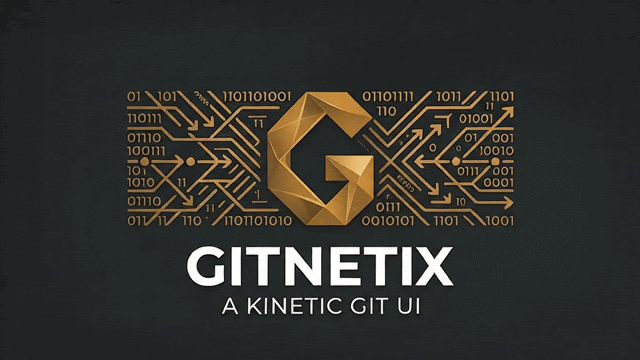

# Gitnetix

<p align="center"></p>

<p align="center"><b>See your work, not your commits.</b></p>

Gitnetix is a Git client with no commit graph. Branches as a tree. Releases from any branch. An agent on every branch.
Runs on macOS, Windows and Linux; pair your phone by QR code to manage it remotely.

Built with a Rust engine, a React UI and a Tauri 2 shell.

Gitnetix shows each branch as a piece of work: what it changes, which release it targets, and whether it is ahead of or behind its base.
You open a branch to see its files and its diff, not a list of hashes.
Every Git action runs the real `git` command, so a repository Gitnetix touches stays readable by any other Git tool.

**Website:** https://gitnetix.app/

## Workflow

- A **release** is a branch `release/x.y.z` cut from `main` (or from the latest tag for a hotfix).
- **Features and fixes** branch off a release, either by switching branch or in their own **worktree**.
- An **AI agent** (Claude Code CLI, Codex, Antigravity…) can work on each branch in parallel.
- **Create tag & Update changelog…** (just **Create tag…** without a `CHANGELOG.md`), in the context menu of every local branch (worktree branches included), dates the `Unreleased` section of `CHANGELOG.md`, tags the branch tip and pushes the branch and the tag together.
  It is disabled while that branch has a rebase or merge in progress. The optional AI step that first adds the branch to the changelog runs after its checks, before anything is committed.
  If origin refuses the push, the branch is left as it was: no tag, no changelog commit.
  A release branch takes its version from its name; any other branch picks **Major**, **Minor** or **Patch**, or **Custom** for a tag name of its own (typing in the tag field switches to it).
  Tags start with `v` or not: the choice is remembered per project, guessed from the existing tags, and also set on the Release row of **Branch types**.
- Release branches merge into `main` like any other branch. A release tagged on its own branch keeps its tag, unless it got new commits after publishing: then the tag moves to cover them. A release merged into `main` first and tagged there keeps its tag on `main`.
- AI writes commit messages, branch names, PR descriptions, release notes, conflict resolutions and ticket triage, driven by editable **templates** and per-task **model routing**.

## Layout

```
crates/core     engine: git CLI wrapper, release flow, AI providers, agents,
                GitHub, Jira/Trello/Asana/Linear, analytics, templates, RPC surface
crates/server   companion HTTP API (+ SSE events), headless server, MCP bridge
src-tauri       Tauri shell: hosts the engine on desktop, remote-only on mobile
src             React UI (all screens from the design canvas)
```

Every client goes through one RPC surface (`crates/core/src/rpc.rs`):
Tauri `invoke("rpc")` on desktop, `POST /rpc` for the phone/browser, and MCP tools for agents.
Adding a method there makes it available everywhere.

## Install

Grab the latest build from [Releases](https://github.com/t1gu1/Gitnetix/releases/latest):
`.AppImage` (Linux), `.dmg` (macOS, Apple Silicon and Intel), `-setup.exe` (Windows).
Installed apps offer new releases on launch.

### macOS: first launch

Gitnetix is too early in development to pay for an Apple Developer ID, so the app is not
notarized. macOS quarantines anything downloaded from the internet and refuses to open
un-notarized apps, saying Gitnetix "is damaged" or "cannot be verified". The app is fine;
macOS just can't check who made it.

After dragging Gitnetix to Applications, clear the quarantine flag once:

```sh
xattr -cr /Applications/Gitnetix.app
```

Or open it once, then go to System Settings › Privacy & Security and click **Open Anyway**.
Updates installed from inside the app don't need this again.

## Run from source

```sh
pnpm install
pnpm app              # desktop app in dev (tauri dev)
GITNETIX_DEV_PORT=1430 pnpm app   # when another app already uses port 1420 (or put GITNETIX_DEV_PORT=1430 in .env.local)
pnpm app:build        # bundle (.app / .dmg / .msi / .deb)
cargo test --workspace
```

Requirements: Rust 1.80+, Node 20+, pnpm, `git` on PATH. The app also needs an agent CLI signed in
(`claude`, `codex`, `agy`, `copilot` or `ollama`), and Agent setup keeps asking until one answers a test.
API keys in AI setup can run the quick AI tasks on top of it.
Gitnetix also finds the copies that Claude Desktop, the ChatGPT and Ollama apps and `gh copilot` keep off PATH.

Headless (no window), e.g. on a dev box you drive from your phone:

```sh
cargo run -p gitnetix-server
```

Config lives in `~/Library/Application Support/gitnetix` (macOS), `~/.config/gitnetix` (Linux),
or `$GITNETIX_HOME`. API keys and tokens go to the OS keychain.

## Mobile (management app)

The iOS/Android build ships the same React UI without the engine. It pairs with a desktop
(or headless) Gitnetix over the companion API and manages releases, agents, worktrees,
PRs and tickets. The layout switches to single-pane with a bottom tab bar under 900 px.

1. Desktop: Menu › Settings › Companion & MCP → enable **Allow devices on my network**, restart.
2. Phone: enter the address and pairing token shown there.

Or scan the QR code on that page: the companion serves the UI itself, so the phone's browser opens
Gitnetix already paired, no native build needed. In dev (`pnpm app`) it serves `dist/`: `pnpm app` builds it when missing, and `pnpm build` refreshes it after UI changes.
On Linux with ufw on, use **Allow through firewall** there (it opens the port to your subnet only).

```sh
pnpm tauri ios init && pnpm ios          # needs Xcode
pnpm tauri android init && pnpm android  # needs Android SDK/NDK
```

`src-tauri/Info.ios.plist` allows local-network HTTP on iOS. On Android release builds, set
`android:usesCleartextTraffic="true"` in the generated manifest (or put the companion behind HTTPS/Tailscale).

The same pairing works from any browser: `pnpm dev` and open http://localhost:1420.

**Security:** the companion API is plain HTTP protected by a 64-hex-char token. Anyone holding
the token on your network can run git and agents on your computer. It listens on 127.0.0.1
unless LAN access is on.

## MCP

`gitnetix-mcp` exposes every RPC method as an MCP tool (stdio), forwarding to the running app:

```sh
cargo build -p gitnetix-server --release
claude mcp add gitnetix -- "$(pwd)/target/release/gitnetix-mcp"
```

## Status

Working and tested (`crates/core/tests/release_flow.rs` drives the full flow on a real repo):
projects, releases, feature/fix branches, worktrees, file lists, diffs, blame and file history, commit/push,
rebase with conflict resolution, branch merge and delete, create tag & update changelog (changelog, tag, push), analytics, companion API, MCP bridge.

Implemented but not yet exercised against live services: AI calls (CLI and API), agent
sessions, GitHub PRs/reviews/releases, Jira/Trello/Asana/Linear.

Not done yet: GitLab / Azure DevOps / Bitbucket / Gitea PRs, French UI strings (the AI output
language setting works; the interface itself is English), mobile builds have not been generated.

---

Made by Guillaume Huard Hughes · [A Dev Journey](https://adevjourney.wtf/en/)
